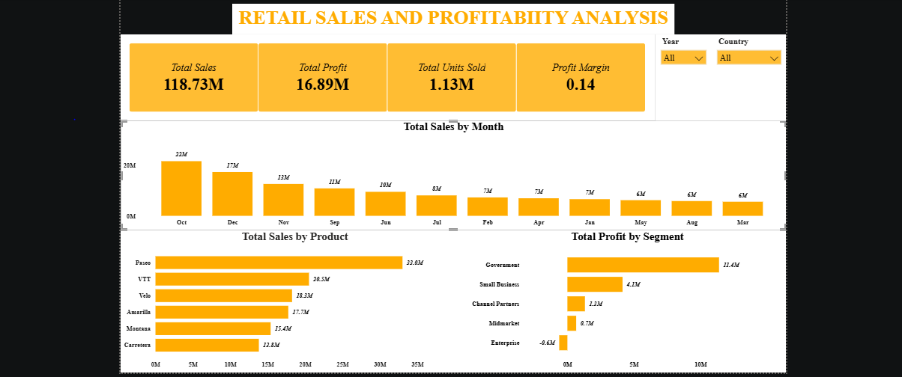

# Retail Sales and Profitability Analysis Using Excel and Power BI

## Project Overview

This project analyzes Microsoft's Financial Sample dataset to evaluate business performance across sales revenue, profitability, products, countries, customer segments, monthly trends, and discount bands.

The objective was to identify key revenue and profit drivers, assess performance differences across business areas, and provide actionable recommendations to support data-driven decision-making.

**Microsoft Excel** was used for data cleaning and preparation, while **Power BI** was used for data visualization and interactive dashboard development.

## Dashboard Preview

## Business Questions

The analysis was designed to answer the following questions:

1. How much revenue and profit did the business generate?
2. Which products performed best and worst?
3. Which countries contributed the most to sales and profit?
4. How did sales change from month to month?
5. Are higher discounts associated with lower profitability?

Additional analysis was conducted to evaluate profitability across customer segments.

## Tools and Technologies

- **Microsoft Excel:** Data cleaning and preparation.
- **Power BI:** Data modeling, visualization, and interactive dashboard development.
- **DAX:** Calculation and presentation of key performance indicators in Power BI.

## Key Performance Indicators (KPIs)

| Metric | Value |
|---|---:|
| Total Revenue | 118.73M |
| Total Profit | 16.89M |
| Total Units Sold | 1.13M |
| Overall Profit Margin | Approximately 14.2% |

The business generated approximately **118.73 million in sales revenue** and **16.89 million in profit**, demonstrating positive overall profitability.

## Data Analysis Process

### 1. Data Cleaning and Preparation — Excel

Microsoft Excel was used to prepare the Financial Sample dataset for analysis.

The cleaned data was then used as the foundation for the Power BI dashboard.

### 2. Data Visualization — Power BI

An interactive dashboard was developed to summarize business performance through:

- KPI cards for total sales, total profit, units sold, and profit margin.
- Monthly sales analysis.
- Product-level sales comparisons.
- Customer segment profitability analysis.
- Year and country filters for interactive exploration.

### 3. Business Insights and Recommendations

The dashboard findings were interpreted to identify areas of strong performance, potential business risks, and opportunities for improvement.

## Key Findings and Insights

### 1. Revenue and Profit Performance

The business generated **118.73M in revenue** and **16.89M in profit**, representing an overall profit margin of approximately **14.2%**.

This indicates that the business was profitable during the period analyzed. However, profitability differed across customer segments, products, and geographic markets.

**Recommendation:** Monitor revenue, profit, and profit margin together to ensure that sales growth translates into sustainable financial performance.

### 2. Product Performance

**Paseo** was the highest-performing product by sales, generating approximately **33.0M**, while **Carretera** recorded the lowest sales among the products analyzed, at approximately **13.8M**.

Other products, including VTT, Velo, Amarilla, and Montana, also contributed significantly to overall sales.

**Recommendation:** Maintain strong marketing and inventory support for high-performing products while investigating opportunities to improve lower-revenue products. Product-level profitability should also be considered before making investment decisions.

### 3. Geographic Performance

The **United States** contributed the highest sales revenue, while **France** generated the highest profit.

This demonstrates that the country generating the most revenue is not necessarily the country contributing the most profit.

**Recommendation:** Compare product mix, pricing, discounts, and profit margins across countries to understand the differences between revenue and profitability.

### 4. Monthly Sales Trends

Monthly sales performance varied across the reporting period.

**October** recorded the highest aggregated sales revenue at approximately **22M**, followed by **December at 17M** and **November at 13M**.

These findings indicate that sales were particularly strong during these months.

**Recommendation:** Use historical sales trends to guide inventory planning, resource allocation, and promotional strategies. Further year-by-year analysis would help determine whether these peaks represent consistent seasonal patterns.

### 5. Discount Impact on Profitability

Total profit was compared across four discount bands:

| Discount Band | Total Profit |
|---|---:|
| Low | 6,188,857.70 |
| Medium | 5,579,522.84 |
| High | 3,388,866.73 |
| None | 1,736,455.00 |

The **Low** discount band generated the highest total profit, followed by Medium, High, and None.

Although the High discount band generated less total profit than the Low and Medium bands, these figures alone do not prove that higher discounts reduce profitability. Differences in sales volume, revenue, and product mix may influence total profit.

**Recommendation:** Compare profit margins across discount bands and examine profitability by product and customer segment to better understand the relationship between discount levels and financial performance.

### 6. Customer Segment Profitability

The **Government** segment generated the highest profit at approximately **11.4M**, followed by the **Small Business** segment at approximately **4.1M**.

The **Enterprise** segment recorded a loss of approximately **0.6M**, indicating that not all customer segments contributed positively to profitability.

**Recommendation:** Investigate the Enterprise segment's pricing structure, discount levels, product mix, and costs to identify the factors contributing to its negative profit.

## Overall Business Recommendations

Based on the analysis, the following actions are recommended:

1. **Strengthen high-performing products:** Maintain commercial support for Paseo while reviewing opportunities to improve lower-performing products.

2. **Improve geographic profitability:** Investigate why the United States leads sales while France leads profit, and identify practices that may improve margins across markets.

3. **Optimize discount strategies:** Evaluate profit margins across discount bands rather than relying only on total profit.

4. **Address loss-making segments:** Review Enterprise segment performance to identify potential pricing, discount, or cost-related issues.

5. **Plan around sales trends:** Use monthly performance patterns to support better inventory, marketing, and operational planning.

6. **Monitor profitability consistently:** Track profit margins alongside sales revenue to support balanced and sustainable growth.

## Project Limitations

- Total profit by discount band does not independently establish whether higher discounts cause lower profitability.
- Monthly sales patterns do not establish the reasons behind revenue fluctuations.
- Product sales rankings are based on revenue and do not necessarily represent product profitability.
- Further analysis of costs, margins, and product mix would strengthen the business recommendations.
- The analysis is based on the historical Financial Sample dataset and should not be interpreted as current business performance.

## Conclusion

This project demonstrates the application of **Excel and Power BI** to transform financial data into meaningful business insights.

The analysis identified key sales and profitability contributors, including Paseo as the leading product by revenue, the United States as the leading sales market, and France as the leading profit market.

It also highlighted the importance of evaluating discounts, customer segments, and geographic performance using profitability measures rather than revenue alone.

The project demonstrates practical skills in data preparation, dashboard development, KPI reporting, business performance analysis, and data-driven recommendations.

## Project Files

- Excel dataset — cleaned financial data used for analysis.
- Power BI dashboard (`.pbix`) — interactive sales and profitability dashboard.
- Dashboard screenshot — visual preview of the completed dashboard.
- README.md — project documentation.

## Skills Demonstrated

**Data Cleaning | Microsoft Excel | Power BI | Data Visualization | KPI Reporting | Sales Analysis | Profitability Analysis | Business Intelligence | Data Storytelling**
